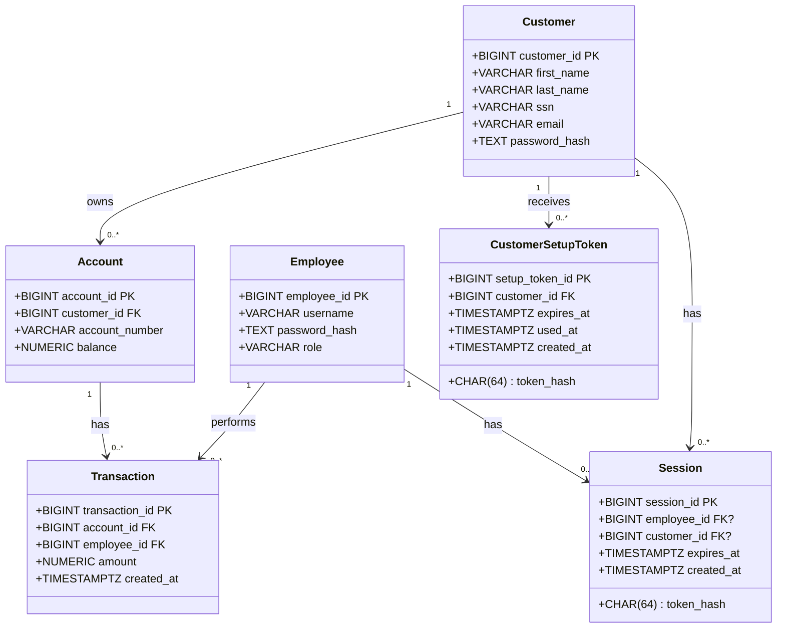

## Tables

#### employees
- `employee_id`
- `username`
- `password_hash`
- `role` — `teller` or `admin`

#### customers
- `customer_id`
- `first_name`
- `last_name`
- `ssn` — masked
- `email`
- `password_hash` — nullable until customer registers and chooses their password

#### accounts
- `account_id`
- `customer_id`
- `account_number` — masked
- `balance`

#### transactions
- `transaction_id`
- `account_id`
- `employee_id`
- `amount` — positive for deposits, negative for withdrawals
- `created_at`

#### sessions
- `session_id`
- `employee_id` — set for employee sessions
- `customer_id` — set for customer sessions
- `token_hash`
- `expires_at`
- `created_at`

#### customer_setup_tokens
- `setup_token_id`
- `customer_id`
- `token_hash`
- `expires_at`
- `used_at`
- `created_at`

## Row-level security

For authenticated requests, the backend sets transaction-local PostgreSQL
settings before executing application queries:

- `app.current_role` — `admin`, `teller`, or `customer`
- `app.current_employee_id` — set for employee sessions
- `app.current_customer_id` — set for customer sessions

Admins and tellers can access customer, account, and transaction records.
Customers can access only their own customer row, accounts, and transactions.
Employees can access their own employee row, while admins can access all
employee rows.

## Relationships

- Customer `1 → 0..*` Account
- Account `1 → 0..*` Transaction
- Employee `1 → 0..*` Transaction
- Employee `1 → 0..*` Session
- Customer `1 → 0..*` Session
- Customer `1 → 0..*` Customer setup token

## UML Class Diagram
