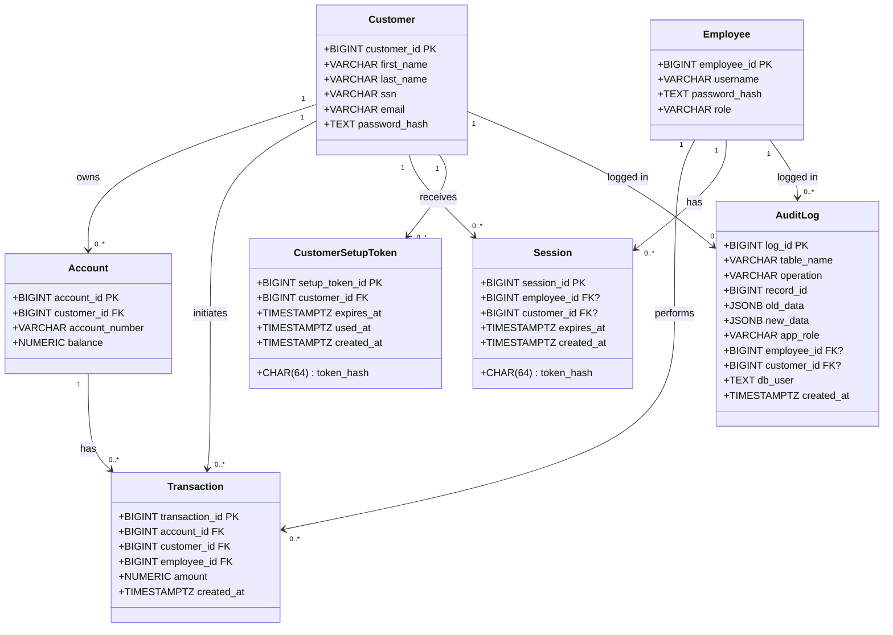

## Tables

#### employees
- `employee_id`
- `username`
- `password_hash`
- `role` — `teller` or `admin`

#### customers
- `customer_id`
- `first_name`
- `last_name`
- `ssn` — masked
- `email`
- `password_hash` — nullable until customer registers and chooses their password

#### accounts
- `account_id`
- `customer_id`
- `account_number` — masked
- `balance`

#### transactions
- `transaction_id`
- `account_id`
- `customer_id` — set for customer-initiated transactions
- `employee_id` — set for employee-initiated transactions
- `amount` — positive for deposits, negative for withdrawals
- `created_at`

#### sessions
- `session_id`
- `employee_id` — set for employee sessions
- `customer_id` — set for customer sessions
- `token_hash`
- `expires_at`
- `created_at`

#### customer_setup_tokens
- `setup_token_id`
- `customer_id`
- `token_hash`
- `expires_at`
- `used_at`
- `created_at`

#### audit_logs
Append-only record of every `INSERT`, `UPDATE`, and `DELETE` on sensitive tables. Written automatically by database triggers.

- `log_id`
- `table_name` — which table was changed (`employees`, `customers`, `accounts`, `transactions`)
- `operation` — `INSERT`, `UPDATE`, or `DELETE`
- `record_id` — primary key of the affected row
- `old_data` — full row snapshot before the change as JSONB (`NULL` for inserts); `password_hash` is stripped
- `new_data` — full row snapshot after the change as JSONB (`NULL` for deletes); `password_hash` is stripped
- `app_role` — session role at the time of the change (`admin`, `teller`, or `customer`)
- `employee_id` — set when an employee session was active
- `customer_id` — set when a customer session was active
- `db_user` — PostgreSQL login role that executed the statement (e.g. `banking_app`)
- `created_at`

`banking_app` has `SELECT` and `INSERT` only — `UPDATE` and `DELETE` are withheld so audit records cannot be erased through the web application.

## Row-level security

For authenticated requests, the backend sets transaction-local PostgreSQL
settings before executing application queries:

- `app.current_role` — `admin`, `teller`, or `customer`
- `app.current_employee_id` — set for employee sessions
- `app.current_customer_id` — set for customer sessions

Admins and tellers can access customer, account, and transaction records.
Customers can access only their own customer row, accounts, and transactions.
Employees can access their own employee row, while admins can access all
employee rows.

The database initializes a separate `banking_app` login role for the backend.
It is not a superuser and does not bypass RLS. `POSTGRES_*` credentials are used
only by PostgreSQL initialization; backend uses `APP_DB_USER` and `APP_DB_PASSWORD`.

## Masked views

Read-only views that mask sensitive fields. They use
`WITH (security_invoker = true)`, so the querying user's RLS policies on the
underlying tables still apply.

- `customers_masked` — `customer_id`, `first_name`, `last_name`, `ssn` as
  `***-**-1234`, `email` (no `password_hash`)
- `accounts_masked` — `account_id`, `customer_id`, `account_number` as
  `*****1234`, `balance`

`banking_app` has `SELECT` only on these views; writes go to the base tables.

## Audit triggers

`06_audit_log.sql` registers an `AFTER INSERT OR UPDATE OR DELETE` trigger on each sensitive table. All four triggers call the same `fn_audit_log()` function, which is a `SECURITY DEFINER` function owned by the superuser so it can always write to `audit_logs` regardless of the caller's privileges. The primary key column name is passed as `TG_ARGV[0]` so a single function handles all tables.

| Trigger | Table watched |
| :--- | :--- |
| `audit_employees` | `employees` |
| `audit_customers` | `customers` |
| `audit_accounts` | `accounts` |
| `audit_transactions` | `transactions` |

## Relationships

- Customer `1 → 0..*` Account
- Account `1 → 0..*` Transaction
- Customer `1 → 0..*` Transaction
- Employee `1 → 0..*` Transaction
- Employee `1 → 0..*` Session
- Customer `1 → 0..*` Session
- Customer `1 → 0..*` Customer setup token
- Employee, Customer, Account, Transaction `→` AuditLog (via triggers)

## UML Class Diagram
