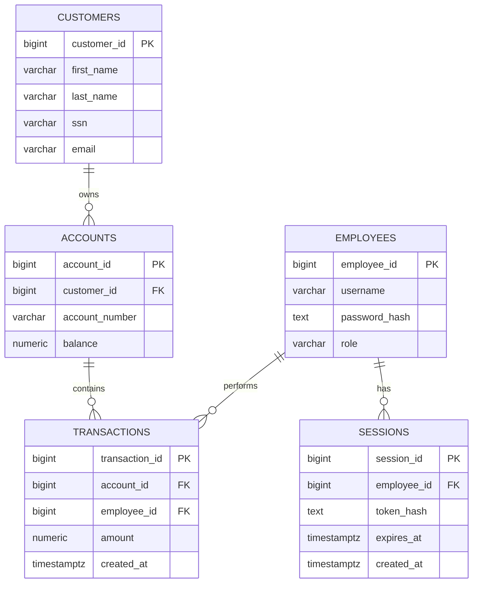

## Tables

#### employees
- `employee_id`
- `username`
- `password_hash`
- `role` — `teller` or `admin`

#### customers
- `customer_id`
- `first_name`
- `last_name`
- `ssn` — masked
- `email`

#### accounts
- `account_id`
- `customer_id`
- `account_number` — masked
- `balance`

#### transactions
- `transaction_id`
- `account_id`
- `employee_id`
- `amount` — positive for deposits, negative for withdrawals
- `created_at`

#### sessions
- `session_id`
- `employee_id`
- `token_hash`
- `expires_at`
- `created_at`

## Relationships

- Customer `1 → 0..*` Account
- Account `1 → 0..*` Transaction
- Employee `1 → 0..*` Transaction
- Employee `1 → 0..*` Session

## UML Diagram

