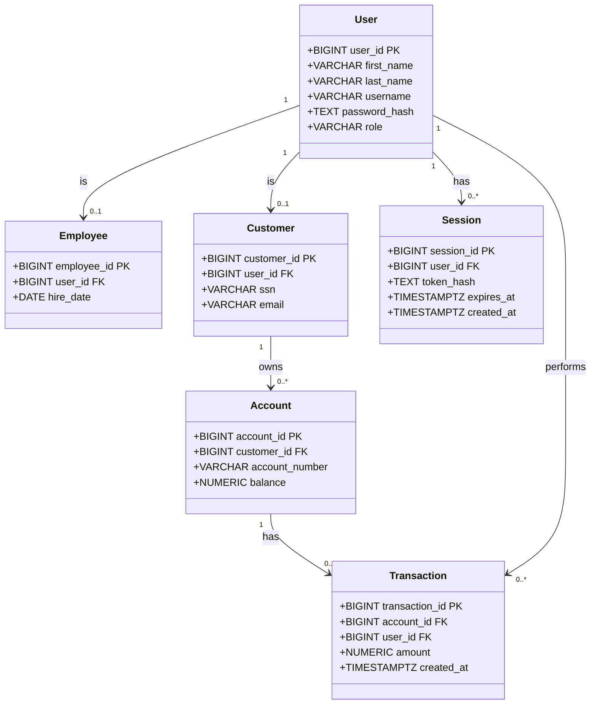

## Tables

#### users
- `user_id`
- `first_name`
- `last_name`
- `username`
- `password_hash`
- `role` — `customer`, `teller`, or `admin`

#### employees
- `employee_id`
- `user_id`
- `hire_date`

#### customers
- `customer_id`
- `user_id`
- `ssn` — masked
- `email`

#### accounts
- `account_id`
- `customer_id`
- `account_number` — masked
- `balance`

#### transactions
- `transaction_id`
- `account_id`
- `user_id` — the authenticated user who performed the transaction
- `amount` — positive for deposits, negative for withdrawals
- `created_at`

#### sessions
- `session_id`
- `user_id`
- `token_hash`
- `expires_at`
- `created_at`

## Relationships

- Customer `1 → 0..*` Account
- Account `1 → 0..*` Transaction
- User `1 → 0..1` Customer
- User `1 → 0..1` Employee
- User `1 → 0..*` Transaction
- User `1 → 0..*` Session

## UML Class Diagram
